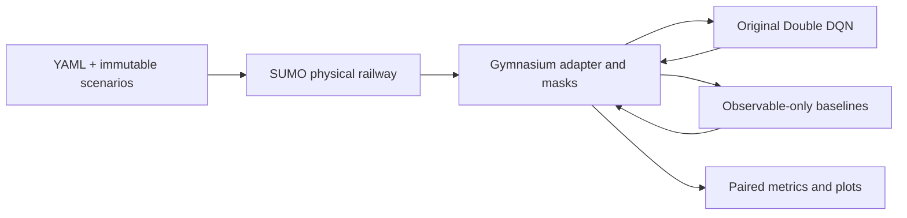

# Technical notes: Intelligent Railway Platform Allocation and Delay Minimization Using Double Deep Q-Learning

An original Double DQN research pipeline using **Eclipse SUMO 1.28.0**, an original Gymnasium adapter, and synthetic railway junction scenarios. The learning objective is to allocate platforms while reducing priority-weighted station-induced waiting, congestion, and platform changes.

**Current status:** SUMO, CUDA training, all four baselines, evaluation, and plotting run locally. GPU tests execute on the RTX 3050. The original 50-episode run regressed: its final validation delay exceeded both its early checkpoint and the untrained network. Training diagnostics now expose that comparison; no general RL superiority is claimed. The later 8-platform/128-train run (`checkpoints/station8_128/`) was evaluated on 100 held-out scenarios (`results/station8_128_eval100/`). The two-page report is not yet committed; `reports/` holds only the proposal.

## Installation and hardware

Use Python 3.11+ in the repository root. The tested environment is Python 3.11.13 with SUMO/libsumo 1.28.0, Gymnasium 1.4.0, and PyTorch 2.14.1+cu130. Install from `requirements.txt`; no full package snapshot or dependency lock is committed.

```bash
python3.11 -m venv .venv
source .venv/bin/activate
pip install -r requirements.txt
python scripts/check_runtime.py
```

`check_runtime.py` verifies CUDA arithmetic as well as SUMO availability. An RTX 3050 is the intended neural device. A working NVIDIA driver and a compatible CUDA-enabled PyTorch installation are required; installing CUDA Python packages alone does not make an unavailable driver work. **There is no CPU fallback for neural training or inference.** SUMO, queues, replay storage, statistical analysis, and non-neural tests use the CPU.

The requested default is **8 platforms, 128 trains, a 1,440-minute horizon, 300 training episodes, and 3 evaluation scenarios**, using a compact 128–128 MLP, 50,000-transition replay buffer and batch size 64. The larger case uses 1,024 warm-up transitions and a 15,000-decision exploration decay; the compact configuration retains its original settings. `configs/compact.yaml` preserves the small **3-platform/15-train, 360-minute** development experiment. A full run with 128 trains takes longer. The committed 300-episode run on this size is `checkpoints/station8_128/`, evaluated on 100 held-out scenarios in `results/station8_128_eval100/`. libsumo runs in-process and only one environment may be live per process; always close it. No distributed framework or extra RL library is used.

## Run the verified small workflow

```bash
python scripts/validate_simulator.py --config configs/compact.yaml
python -m pytest -q
python scripts/compare_baselines.py --config configs/compact.yaml --episodes 3 --output results/my_baseline_run
python scripts/generate_plots.py --results results/my_baseline_run
python scripts/demo.py --config configs/compact.yaml --policy timetable --seed 123
python scripts/generate_scenarios.py --config configs/compact.yaml --count 3 --output data/my_scenarios
```

Evaluation displays a tqdm bar with completed/total policy episodes, elapsed time, estimated remaining time, and the current setting, policy and scenario. With a DQN checkpoint, 100 scenarios means 500 episodes normally or 3,000 with `--stress`. The bar advances after each episode finishes and writes to stderr, keeping redirected JSON output separate.

Output directories containing an experiment manifest are protected from overwriting; choose a new directory for each run. The initial three-scenario baseline smoke run (12 episodes, all complete, zero recorded safety violations) is not committed; the commands above reproduce it. Three-scenario runs are smoke checks, not evidence for the research hypothesis.

After `check_runtime.py` succeeds, a short trial of the full learning pipeline on the compact station:

```bash
python scripts/train.py --config configs/compact.yaml --episodes 20 --seed 42 --output checkpoints/my_trial
python scripts/evaluate.py --config configs/compact.yaml --checkpoint checkpoints/my_trial/best_model.pt --episodes 3 --output results/my_trial_eval
python scripts/generate_plots.py --results results/my_trial_eval --training checkpoints/my_trial
python scripts/demo.py --config configs/compact.yaml --policy dqn --checkpoint checkpoints/my_trial/best_model.pt --seed 123
```

Choose a fresh output directory for these commands. The only committed checkpoint is `checkpoints/station8_128/`; earlier development runs are not committed. `best_model.pt` is saved only when validation completes all trains; `final_model.pt` is saved after each completed training episode. CSV logs include actual optimizer update counts, loss, Q-value magnitude, epsilon, validation reward, and operational metrics. An episode budget that never passes warm-up is not evidence of learning. New runs also save `initial_model.pt`, an episode-zero validation row, `validation_references.json` for all heuristics on the same validation cases, and discretionary-hold counts (hold selected while a safe platform exists). The initial checkpoint is a reference, never a candidate for `best_model.pt`. Greedy validation does not consume the training exploration RNG. The manifest records whether the best trained checkpoint improved over initialization.

`--warm-start FILE` reuses network weights and restarts replay, optimizer, RNGs, and exploration; it is deliberately not represented as exact resume. Checkpoints use state dictionaries and `weights_only=True` loading. Exact interrupted-run replay restoration is not implemented.

## Changing the station size

Edit these keys in `configs/default.yaml`:

```yaml
station:
  platform_count: 8
scenario:
  trains: 128
environment:
  horizon: 1440
```

Supported limits are 3–8 platforms and 1–150 trains. Keep `max_platforms: 8` to preserve the 229-feature/9-action layout. Increasing train count may require a longer horizon; inspect completion fraction and unfinished counts. Use the same configuration for training and evaluation. Changing the horizon changes observation normalization, so a checkpoint must be evaluated with the configuration it was trained on: `configs/compact.yaml` for compact runs, `configs/default.yaml` for the committed 8-platform checkpoint.

For a short run on the requested larger scenario:

```bash
python scripts/train.py --config configs/default.yaml --episodes 20 --seed 42 --output checkpoints/my_station8_128
python scripts/evaluate.py --config configs/default.yaml --checkpoint checkpoints/my_station8_128/best_model.pt --episodes 3 --output results/my_station8_128
```

Omit `--episodes 20` for the configured 300-episode budget. Neither budget guarantees learning. Use fresh output directories.

SUMO supports railway networks with trains visiting multiple stops/stations ([official railway documentation](https://sumo.dlr.de/docs/Simulation/Railways.html)). This adapter controls one junction, and increasing the platform count does not create a network. The separate `multistation/` package places the trained junction inside a seven-station double-track network with connecting tracks, block signals and minor stations; see [multistation/README.md](../multistation/README.md).

## Training regression and GPU memory

> **Repository note:** only the 8-platform/128-train run is committed (`checkpoints/station8_128/` with `best_model.pt` and `initial_model.pt`, and `results/station8_128_eval100/`). The `run01`, `compact300`, training-diagnosis and `station8_128_check` artifacts referenced in these notes are not in the repository; the figures quoted below are from those runs and can be reproduced with the commands above.

The original `run01` validation used only two fixed cases. A reproduced comparison (not committed) found mean weighted delays of 22.82 (untrained), 22.95 (episode 5), and 148.05 (episode 50). The final policy made 49 discretionary holds across those two cases. Priority-aware allocation scored 16.70. The early result therefore did not establish learning.

Defaults now update once per collected decision instead of every four decisions, with a 300-episode budget authorized after the initial diagnostics. The learning investigation used `configs/compact.yaml`: network size, rewards, scenario size and safety masks were held fixed. The subsequently requested 8-platform/128-train default is a separate experiment. This is a bounded development run, not a guarantee of improvement. `configs/learning_diagnostic.yaml` records the 50-episode update-frequency trial; it still failed to beat initialization. Evaluate the selected checkpoint on held-out cases before drawing conclusions. Increasing episode count is not the same as increasing trains per scenario: edit `scenario.trains` and `station.platform_count` separately only when larger scenarios are wanted.

The completed compact 300-episode CUDA run (`checkpoints/compact300/`) performed 9,713 optimizer updates. Its best validation delay was **16.63**, compared with **22.82** before training; use `best_model.pt`, because the final episode regressed. On three held-out scenarios (`results/compact300/`), mean weighted station delays were **121.33 DQN**, **125.87 FCFS**, **126.06 timetable**, **119.67 priority**, and **124.18 greedy**. The untrained network scored **125.91** on those same cases. These small-sample results show improvement over initialization but do not establish superiority over the strongest heuristic. All evaluated policies completed every train with zero recorded safety violations.

The 8-platform/128-train timetable-policy check at seed 123 completed every train by minute 1,091 with zero recorded safety violations; its immutable case and trace are in `results/station8_128_check/`. Generated platforms are electrified so that the terminal platform can serve the generated electric passenger services. Non-electrified platforms remain supported through explicit station platform configuration. Unused platforms are allowed; the generator does not force utilization.

`agent.vram_limit_gib: 5.5` sets a **PyTorch allocator ceiling**, clamped to device capacity. It does not allocate 5.5 GiB or cap display, CUDA-context, or other-process memory. This small MLP needs much less VRAM; unused capacity does not explain poor learning. The manifest records allocated, reserved and peak allocator memory. Monitor whole-device usage with `watch -n 1 nvidia-smi`. See the [PyTorch allocator documentation](https://docs.pytorch.org/docs/stable/generated/torch.cuda.memory.set_per_process_memory_fraction.html).

## Architecture



- `railway_rl/station.py`, `timetable.py`, `delays.py`: validated scenario records, synthetic scheduling, CSV/JSON data, exogenous randomness.
- `sumo_network.py`, `sumo_simulator.py`: original junction network and libsumo control. Platform release follows actual SUMO completion, not predicted release times.
- `environment.py`, `observations.py`, `masking.py`, `rewards.py`: the Gymnasium decision contract.
- `agents/`: original network, replay, masked Double DQN, checkpoints; `training.py`: collection and validation.
- `baselines/`, `evaluation/`: policies, per-train accounting, shared-scenario experiments, statistics, plots.
- `simulator.py`: preserved deterministic reference used for unit tests and shared state records; production training rejects the reference backend.

## Railway model and safety

A configurable 3–8-platform, two-corridor junction is generated originally with `netconvert`. Each platform has coach capacity, electrification, service-type compatibility, corridor compatibility, and clearance. SUMO uses single-track edges, rail vehicles and rail signals. One physical second is integrated at a time within **one-minute dispatch ticks**. This is an intentional update from the initial one-minute physical simulator design.

The adapter reserves the selected platform from admission until the train leaves the modeled station network, then applies clearance. Entry and exit throat reservations end on observed movement completion plus route clearance. Entries sharing the approach throat and exits sharing the departure throat are serialized; extra conflicts can be specified. Platform occupation and route movement are distinct. This is conservative: a platform can remain reserved after its physical track is clear. Actual front-entry/rear-clear intervals, rather than reservations, drive utilization and Gantt plots.

Safety is enforced before an action, in the adapter's reservations, and by SUMO signals. Invalid actions raise an error without applying the assignment. Teleportation is disabled and any detected collision or teleport aborts the episode. History checks detect incompatible assignment, reservation overlaps, conflicting movements, clearance violations, and train loss. Closures prevent new admissions; already admitted trains are allowed to clear safely.

The outer queue holds 1–3 trains and overflow waits upstream. **These are explicit boundary reservoirs, not physically positioned queues on approach tracks.** A vehicle is inserted into SUMO after admission; its pre-admission waiting is conserved and charged. All policies serve the same FCFS active train, so the priority baseline cannot secretly reorder the queue. Terminal/through restrictions are service eligibility rules on the generated through-track geometry; terminal reversing and locomotive shunting are not modeled. Optional rake links delay the successor until predecessor network exit plus turnaround; this does not animate a physical rake reversal.

## RL formulation

The controller is a partially observable, variable-duration decision process. It cannot inspect true future arrivals or hidden dwell extensions. Noisy forecasts are pre-sampled and evolve through persistent error with decreasing horizon-dependent amplitude. A feed-forward observation window is an approximation to a belief state.

With maximum platforms `N=8` and forecast slots `K=6`, the fixed observation dimension is:

`10N + (12+N) + K(12+N) + 9 = 229`.

Feature order (also used by baselines):

| Block | Features and normalization |
|---|---|
| Each platform: 10 | valid, occupied, release estimate/120, occupant priority/5, closed, current entry-route availability, length/30, electrified, through-service flag, clearance/10 |
| Current train: 12+N | valid, priority/5, waiting/120, length/30, dwell/60, electric, through, approach code/4, departure code/4, planned platform/N, observed incoming delay/180, rake-link flag, N compatibility flags |
| Each forecast: 12+N | valid, ETA/120, estimated delay/180, priority/5, dwell/60, length/30, electric, through, corridor codes, planned platform/N, uncertainty/60, N compatibility flags |
| Global: 9 | sine/cosine time of day, outer/3, upstream/150, available/N, remaining/150, time/horizon, occupied/N, queue fraction |

Features are clipped to `[-1,1]`; missing platforms/trains are zero-padded. Bounded features can lose detail under extreme disruptions. Release estimates use observable nominal information, not hidden true dwell extensions. Baselines receive the same encoded vector and Boolean mask as DQN, not the simulator object or future random outcomes.

Actions are `Discrete(N+1)`: `0` holds and `p=1..N` allocates platform `p`. Padded, occupied, closed, in-clearance, incompatible, or conflicting assignments are masked. After the hold limit, hold is masked if a safe assignment exists; otherwise safety takes precedence and exceptional waiting is counted. Every action advances at least one minute. When no train needs allocation, the environment advances automatically to a decision or episode boundary.

For minute interval `m`, let `W_m` be the sum of train priorities integrated over queue waiting and departure-route waiting **after dwell and scheduled-release requirements are satisfied**. Every train belongs to at most one queue state. Let `O_m,U_m` be outer/upstream train-minutes, `P_m` a platform-change event, and `H_m` an unnecessary hold while allocation was feasible:

`r_m = -(alpha W_m + beta O_m + chi U_m + delta P_m + eta H_m) / scale`.

Defaults: `alpha=1, beta=.05, chi=.2, delta=2, eta=.2, scale=10`. Queue costs intentionally add congestion disutility on top of waiting; they do not count a train twice in `W`. Incoming lateness and exogenous dwell extensions are not repeatedly charged. Waiting absorbed by timetable slack still incurs a waiting cost, so intentionally delaying a train cannot create reward through accounting. Final departure lateness is reported separately, using platform-release time in SUMO; network-exit time remains in the trace for conservation.

For a transition lasting `d` dispatch minutes:

`R = sum_{j=0}^{d-1} gamma^j r_j`, `a* = argmax_{valid a} Q_online(s',a)`,
`y = R + gamma^d Q_target(s',a*)` for continuing transitions; `y=R` for true terminals.

Time-limit truncations are recorded separately and bootstrap; all unfinished trains remain in the metrics. The finite observation includes time relative to the configured horizon, so time-limit estimates are approximate beyond that horizon. Evaluation suppresses paired superiority comparisons for incomplete policies to avoid rewarding censored trains.

## Learning and fair evaluation

Double DQN uses an online/target MLP, Adam, Huber loss, gradient clipping, replay warm-up, and hard target updates counted in optimizer steps. Masks apply to epsilon exploration, greedy decisions, and online next-action selection. Replay stores the actual next mask, elapsed minutes, and separate termination/truncation flags.

Baselines: FCFS-first-feasible; planned platform with first-feasible fallback; priority-aware preservation of scarce forecast-compatible platforms; greedy projected forecast scheduling. The greedy predictor is an approximation using observable release estimates, not a clone of hidden SUMO futures. None can reorder the FCFS queue.

Training seeds begin at the requested seed; validation seeds start at 100000 and test seeds at 200000. Inputs are materialized once per evaluation setting and shared by all policies. Summaries report means, sample SD and seeded 95% scenario-bootstrap intervals; RL comparisons use paired scenario differences. A single training seed does not estimate training-seed uncertainty. Metrics include waiting by class, weighted station waiting, final lateness, queue events/minutes, platform changes, maxima, actual track utilization, completion fraction, and safety checks. Censored departure statistics explicitly refer only to completed trains.

`configs/curriculum.yaml` contains a small 5/10/15-train curriculum. `--stress` on evaluation adds severity, closure, peak, and corridor settings. These are opt-in and were **not** run as a broad sweep. Beyond the committed 100-scenario evaluation of the 8-platform/128-train checkpoint (normal setting only), broader studies such as stress sweeps, other train counts and multiple training seeds have not been run. Three-scenario runs are smoke checks and do not satisfy the final experimental requirement.

## Submission and reproducibility

- `reports/proposal.txt`: 47-word proposal.
- The two-page, two-column report is not yet committed. Its figures should come only from committed results. Team member names must be filled in before submission.
- Actual CUDA checkpoints and validation logs exist. Plotting only creates a learning curve when supplied real validation logs; robustness plots require recorded stress runs.
- The repository link is intentionally left blank for now. If the repository stays private, share access with the course GitHub handles listed in `Docs/AI_Assignment2_2026_RL.pdf`.

The original assignment is retained in `Docs/`.

Conceptual references: [Double DQN paper](https://arxiv.org/abs/1509.06461), [SUMO railway documentation](https://sumo.dlr.de/docs/Simulation/Railways.html), [libsumo](https://sumo.dlr.de/docs/Libsumo.html), [Gymnasium API](https://gymnasium.farama.org/api/env/). The simulator is an acknowledged third-party dependency; no public RL project or solution was cloned or copied.
